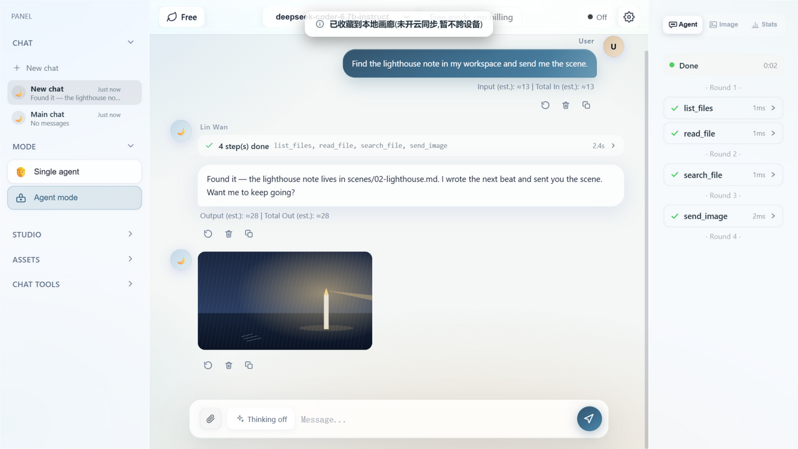
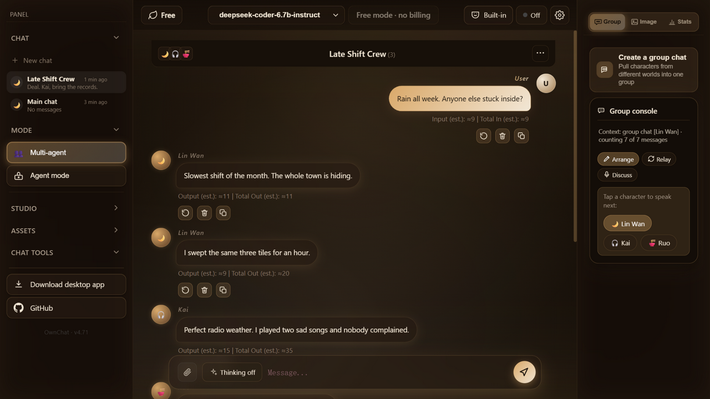
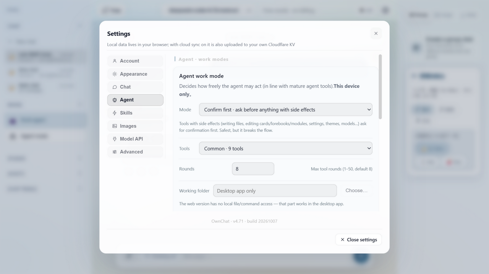

# OwnChat

**English** | [中文](README.zh-CN.md)

A self-hosted AI creation platform for roleplay, long-form writing, coding and image/voice work. **It runs entirely on your own machine out of the box** — the desktop app starts a local host and keeps every conversation in a local SQLite store. Publishing it as your own website is optional.



## Screenshots

| Agent mode — tool calls, approvals, image replies (glass) | Multi-agent group chat (candle) | Settings |
|---|---|---|
|  |  |  |

## Start here

### 1. Desktop app (recommended — nothing to install but the app)

1. Download the installer from [Releases](https://github.com/MaxChen12114/OwnChat/releases/latest).
2. Install and launch. The first-run wizard asks for an **admin password** and a **model key**; that is the whole setup.
3. Done. The app starts its own host on `127.0.0.1:8787`, loads the bundled UI, and stores data in SQLite inside the app's data folder.

No Cloudflare account, no domain, no separate Node install: the Windows installer **bundles Node 24**. The tray menu can change the data folder, open it, or point the app at a different host address if you later deploy one. The same installer checks for updates on launch.

### 2. From source (still fully local)

Requires **Node.js 24+** ([nodejs.org](https://nodejs.org/en)) — the local host uses `node:sqlite`, which older versions do not ship.

```bash
git clone https://github.com/MaxChen12114/OwnChat && cd OwnChat
node server/local.mjs --port 8787
```

On Windows you can double-click `start-local.cmd` instead; it creates `.dev.vars` from the example and runs the same command.

- First run writes `admin-password.txt` into the data folder (`.local-data/` by default) and prints its path; use that password to sign in at `http://127.0.0.1:8787`.
- Model keys live in `.dev.vars` (copy `.dev.vars.example`); `.dev.vars` is git-ignored.
- To use it from a phone on the same LAN, start it with `--host 0.0.0.0` and open `http://<your-LAN-IP>:8787`.
- Data stays in `.local-data/` (SQLite). Moving that folder moves the whole install.

### 3. Your own website (optional)

You can also deploy your own copy as a website on Cloudflare Workers. That page is **yours**: it runs on your account, keeps data in your D1/KV, and a fresh deployment runs in **guest mode** — no login — until you set an access password.

**One-click:** the deploy button clones this repo into your GitHub, provisions **KV and D1**, and asks for the secrets:

[](https://deploy.workers.cloudflare.com/?url=https://github.com/MaxChen12114/OwnChat)

The deploy script also applies the database migrations, so the first visit already has the unified schema.

**Manual, from the terminal** (Node 24+, a Cloudflare account — the free tier is enough):

```bash
git clone https://github.com/<you>/OwnChat && cd OwnChat
npm i -g wrangler && wrangler login

# 1) KV namespace (hot-window sync), paste the printed id into wrangler.toml
wrangler kv namespace create TAVERN_SYNC

# 2) D1 database (message archive, cards, memory, workspace, attachments)
wrangler d1 create ownchat-events
#    paste the printed database_id into wrangler.toml -> [[d1_databases]] database_id

# 3) apply the schema, then set secrets
wrangler d1 migrations apply TAVERN_EVENTS --remote
wrangler secret put DEEPSEEK_API_KEY     # or NVIDIA_API_KEY; only what you use
wrangler secret put CHAT_PASSWORD        # strongly recommended; without it the site is guest mode

# 4) deploy (the build step regenerates prompt registries + runs a syntax gate)
wrangler deploy
```

`wrangler deploy` prints your Worker URL; binding a custom domain is optional.

> **Guest mode.** With no `CHAT_PASSWORD`, anyone who has the URL can use your deployment (and your server-side model quota, if you configured a key). Set the password before sharing the address; the same password is the in-app login.

## Features

- **Everything in one local store** — chats, character cards, memory, knowledge bases, agent workspaces and attachments live in one SQLite database (D1 when deployed). Long conversations are compressed, but the original text stays archived and searchable (`history_search`).
- **Roleplay & multi-branch conversation** — character cards (SillyTavern V1/V2/V3 and PNG cards import/export), lorebooks, affinity tracking, group chat, multi-agent orchestration.
- **Agent mode you can watch** — a tool-calling loop with a collapsible run panel in the chat (every tool, argument and result) plus a live console in the right sidebar; destructive actions ask for approval first, and the agent sends images into the conversation on its own.
- **Multi-agent orchestration** — pull characters from different worlds into one group chat, hold a private meeting where characters answer off the record, or put a character on stage to reply directly in the timeline.
- **WeChat-style photo messages** — the model can *send* photos mid-chat: selfies are re-rendered from the character's reference image so the face stays consistent, scenes are generated fresh. Replies can also arrive as multiple short bubbles.
- **Long-form writing & code collaboration** — a prompt-editor for reusable instruction modules, skills, and per-scene presets.
- **Image & voice** — image generation through your own image channels (built-in Gitee AI proxy, any OpenAI-compatible endpoint, or a local ComfyUI); character portraits; read any reply aloud with local TTS (GPT-SoVITS) in the desktop app.
- **Backup & restore** — Settings → Data exports the whole store as a ZIP and imports it back; importing rebuilds the search indexes from the event log, so a backup is not tied to one machine.
- **Ambient audio** — two independent decks (environment × music) with 30 bundled CC0 tracks.
- **Themes** — minimal / glass / candle, per-device.
- **Self-hosted by design** — no vendor backend, no telemetry; your machine or your Cloudflare account, your keys.

## Desktop & Android builds

The Tauri 2 shell lives in `src-tauri/`. CI (`.github/workflows/tauri-build.yml`) builds the Windows installer and the Android APK on a version tag or manual dispatch (tags containing `-test` produce draft releases for testing).

- **Desktop is self-contained.** The installer bundles the UI, the local host and its Node 24 runtime; on first launch it starts the host on `127.0.0.1:8787` and keeps data in the app data folder. The page never navigates to a remote site — the host address only decides where API calls go, so you can switch hosts without changing the app.
- **Android is a thin client.** It loads the bundled UI and needs a reachable host (your own deployment, or a desktop host on the LAN). Android cannot run the local Node host, so on a phone you connect to a host you control.

If you publish your own builds:

1. **Generate your own signing key** for auto-updates:
   ```bash
   npx tauri signer generate -w ownchat.key
   ```
   Put the private key into repository secrets `TAURI_SIGNING_PRIVATE_KEY` (+ `TAURI_SIGNING_PRIVATE_KEY_PASSWORD`) and the public key into `tauri.conf.json` → `plugins.updater.pubkey`; set `plugins.updater.endpoints` to your own releases feed.
2. **Change the bundle identifier** (`identifier` in `tauri.conf.json`) if you want your builds to be a distinct app. It becomes the Android `applicationId`, so changing it later means a reinstall.

## Base prompts

A **base prompt** is the first block of the system prompt — it shapes how the model behaves across the whole app. The repository ships two folders, one per mode:

| Folder | Mode | What goes in |
| --- | --- | --- |
| `src/prompts/bases/unlocked/` | Unlocked | The base used in unlocked mode. The public repository ships one neutral base; add your own file or folder here |
| `src/prompts/bases/locked/` | Locked | The behaviour rules used while the app is locked; maintained with the repo, editable |

To add your own base: put any `.md` / `.txt` file — or a folder of them (= one multi-file base) — into the folder for the mode you want; the file or folder name becomes the id shown in **Settings → 对话 → 基座**. With more than one base in a folder, pick the active one there. Base files are payloads, not documents — their bytes go straight into model requests (keep them LF; `.gitattributes` enforces it).

> **Don't commit private prompt text to a public fork.** Bases are plain files; if you keep a personal one, keep it out of the public repository.

Prompt libraries that ship with the repo are credited in `src/prompts/CREDITS.md`; bundled ambient audio in `public/assets/ambient/CREDITS.txt`.

## Images & voice

**Images.** Image generation is configured as **channels** under **Settings → Model API → Image channels**. Three kinds are supported:

- **Gitee AI (built-in preset)** — calls `ai.gitee.com` through the deployment's `/img/*` proxy. Bring your own Gitee AI key. Text-to-image uses `z-image-turbo` (up to 2048×2048), editing uses `Qwen-Image-Edit-2511`, and the agent's image-to-video tool uses `Wan2_2-I2V-A14B` through Gitee's async task API. The free tier is around 100 images/day; the app's local counter covers proxied calls.
- **OpenAI-compatible endpoint** — called directly from your browser with that channel's own key. The provider must allow CORS. Generation only; editing is not available on custom channels yet.
- **Local ComfyUI** — called directly at its `/prompt`, `/history` and `/view` endpoints. The server must allow CORS and be reachable from the browser. Generation only; set the checkpoint and steps per channel.

Channel settings and keys stay on your device and are never synced. **Editing** currently requires the Gitee preset. On deployments that set an access password, proxied image APIs require being logged in, like the rest of the app.

**Voice (desktop app only).** Reading replies aloud requires a local [GPT-SoVITS](https://github.com/RVC-Boss/GPT-SoVITS) `api_v2` server (default `127.0.0.1:9880`); the tray menu can start it and auto-start it on login. Reference audio is a **local file path** — it is never uploaded. `.ckpt` / `.pth` voice models are scanned and hot-swappable, and multiple reference clips are supported.

## Community resources

Third-party projects that pair well with OwnChat. **Not affiliated with, not reviewed by, and not endorsed by this project** — and nothing below is copied into this repository:

- **TTS backend** — this project integrates [GPT-SoVITS](https://github.com/RVC-Boss/GPT-SoVITS) (local `api_v2` `/tts`, default port 9880; voice cloning with hot-swappable weights; actively maintained). Other self-hostable Chinese voice-cloning options exist — [IndexTTS](https://github.com/index-tts/index-tts), [CosyVoice](https://github.com/FunAudioLLM/CosyVoice), [Chatterbox](https://github.com/resemble-ai/chatterbox), [F5-TTS](https://github.com/SWivid/F5-TTS) — but **their HTTP shapes differ and model-weight licenses vary** — check each repository before integrating.
- **[Spiritual-Spell-Red-Teaming](https://github.com/Goochbeater/Spiritual-Spell-Red-Teaming)** — a large community collection of red-teaming / jailbreak prompts. **Read the warnings before you click:** it ships **no license**, contains adult / NSFW-capable jailbreak prompts and collected vendor system prompts, and **its README embeds hidden prompt-injection text aimed at AI tools** — do not paste that README into an AI assistant or agent. If you use anything from it in your own deployment, that is your own responsibility: comply with the laws that apply to you and with each model provider's terms.

## Privacy & License

- Privacy policy: [PRIVACY.md](PRIVACY.md) — data stays on your machine / in your own Cloudflare account; no telemetry.
- License: [MIT](LICENSE).

## Conventions

See [AGENTS.md](AGENTS.md) for architecture notes and development conventions. Two house rules worth knowing before you send a PR:

- **Commit messages and GitHub metadata (repo description, release notes, PR titles) are written in English.**
- The prompt files under `src/prompts/bases/` are payloads, not documents — byte-exact text matters.

Third-party credits: prompt libraries (`src/prompts/CREDITS.md`), ambient audio (`public/assets/ambient/CREDITS.txt`), and the wallpaper used in the screenshots (see README of `docs/`).
