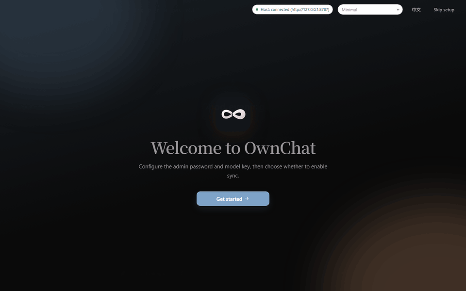
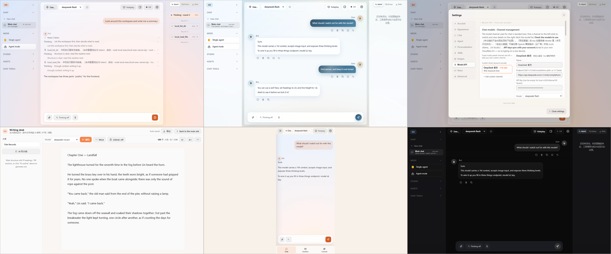

# OwnChat

**English** | [中文](README.zh-CN.md)

[](LICENSE)
[](https://workers.cloudflare.com/)
[](https://tauri.app/)
[](https://nodejs.org/)
[](PRIVACY.md)



## Screens



Six screens in one image: agent mode, group chat, messages, themes, writing and the phone layout. Click for the full size.

-----

## Overview

OwnChat runs on your machine. The desktop app starts a local host on `127.0.0.1:8787`, loads the interface from resources inside the installer, and writes data to a SQLite database in the app's data folder. Roleplay, long-form writing, code collaboration, and image and voice work share one interface.

It does not call a vendor backend and does not collect usage data. The same code deploys to Cloudflare Workers as your own site, or runs as a local web app through `node server/local.mjs`; all three paths share one interface and one data model.

It has no multi-user or permission model. One deployment or one data folder serves one person; deploy separately to separate users.

-----

## Quick start

| Path | Use it when | You need |
| --- | --- | --- |
| Desktop app | You want to use it | The Windows installer |
| From source | You want to read or change the code | Node.js 24+ |
| As a website | Others need access, or you want sync across networks | A Cloudflare account; the free tier is enough |

### Desktop app

The installer bundles the Node 24 runtime, the local host and every page asset.

1. Download the latest installer from [Releases](https://github.com/MaxChen12114/OwnChat/releases/latest).
2. Install and launch. The first-run wizard asks for an admin password and a model key; the sync switch is optional.
3. The app starts its host on `127.0.0.1:8787` and writes data to the app data folder.

The tray menu can change the data folder, open it, or point the app at a different host address. It checks for updates on launch. Only a Windows installer is published; macOS and Linux run the local host from source.

### From source

Requires Node.js 24+; the local host uses `node:sqlite`.

```bash
git clone https://github.com/MaxChen12114/OwnChat && cd OwnChat
node server/local.mjs --port 8787
```

On Windows, `start-local.cmd` runs the same command.

First launch writes `admin-password.txt` into the data folder (`.local-data/` by default) and prints its path; use it to sign in. Model keys live in `.dev.vars`, copied from `.dev.vars.example`; the file is git-ignored. To reach it from a phone on the same LAN, start with `--host 0.0.0.0` and open `http://<LAN-IP>:8787`. The data folder is the whole installation: moving it moves everything.

### As a website

Deployed to Cloudflare Workers, the site runs in your account, keeps data in your D1/KV, and syncs a phone and a desktop across networks. A deployment with no `CHAT_PASSWORD` is in guest mode: anyone with the address can use it, including the server-side model quota you configured.

[](https://deploy.workers.cloudflare.com/?url=https://github.com/MaxChen12114/OwnChat)

The button clones the repo into your GitHub, creates KV and D1, and asks for the secrets. The deploy script applies the database migrations, so the first visit already uses the unified schema.

<details>
<summary>Deploy from the terminal</summary>

Requires Node 24+ and a Cloudflare account:

```bash
git clone https://github.com/<you>/OwnChat && cd OwnChat
npm i -g wrangler && wrangler login

# KV: hot-window sync — paste the printed id into wrangler.toml
wrangler kv namespace create TAVERN_SYNC

# D1: message archive, cards, memory, workspace, attachments
wrangler d1 create ownchat-events
# paste the printed database_id into wrangler.toml -> [[d1_databases]] database_id

# apply the schema, then set secrets
wrangler d1 migrations apply TAVERN_EVENTS --remote
wrangler secret put DEEPSEEK_API_KEY     # or NVIDIA_API_KEY — only what you use
wrangler secret put CHAT_PASSWORD        # without it the site is guest mode

# deploy; the build step regenerates prompt registries and runs a syntax gate
wrangler deploy
```

`wrangler deploy` prints the Worker URL; a custom domain is optional.

</details>

-----

## Features

| | |
| --- | --- |
| Data plane | Chats, character cards, memory, knowledge bases, agent workspaces and attachments in one SQLite database (D1 when deployed); long conversations are compacted to the context budget and the original text stays in the event log for `history_search` |
| Cross-device sync | Five channels merge by their own keys (chats by slot hash, cards by id, cost by day × device, exclusions by timestamp) with tombstone deletes; provider settings and keys sync with the account |
| Models | The list is pulled from `/v1/models` and chosen in settings, so version ids are never hard-coded; DeepSeek official and an NVIDIA free tier are built in, and any OpenAI-compatible endpoint can be added; thinking levels map per model |
| Backup | Settings → Data exports the whole store as a ZIP; importing rebuilds the search indexes from the event log, so a backup restores on another machine |
| Roleplay | SillyTavern V1/V2/V3 and PNG character cards, lorebooks, affinity, multi-branch conversation |
| Group chat | Several characters in one conversation; private meetings stay off the timeline; a character can reply inline; the main agent delegates to sub-agents and reclaims their permissions when the task ends |
| Agent runs | Each tool call expands into a run panel with the tool name, arguments and result; the right sidebar console shows the current step; side-effecting calls ask for approval first |
| Messages | The model can send images mid-conversation, with selfies re-rendered from the character reference; one reply can arrive as several short messages |
| Writing and code | A prompt editor for instruction modules, skills and scene presets; syntax highlighting |
| Image channels | The built-in Gitee AI preset, any OpenAI-compatible endpoint, or a local ComfyUI |
| Voice | The desktop app reads replies aloud through a local GPT-SoVITS server; reference audio is a local path and is never uploaded |
| Ambient audio | Independent environment and music decks with 30 bundled CC0 tracks; the model can switch them from roleplay context through hidden tags |
| Phone | The same deployment switches to a single column and a capsule composer on a phone; the Android build connects to the host you configure |

## Known limitations

These are current boundaries of the product, not a task backlog.

- **Only a Windows installer is published.** macOS and Linux run the local host from source.
- **Cross-device sync needs a host both devices can reach.** A purely local run syncs only inside one LAN.
- **Android is a thin client.** It loads the bundled interface but needs a reachable host; it cannot run the local Node host.
- **Voice needs a separate local service.** Reading aloud requires a local GPT-SoVITS `api_v2` server (default `127.0.0.1:9880`); no model weights ship with the repository.
- **Image editing requires the Gitee preset.** OpenAI-compatible endpoints and local ComfyUI only generate.
- **Long conversations are compacted.** Messages beyond the context budget are summarized; the text stays searchable in the event log but no longer reaches the model context.
- **One deployment serves one person.** There are no accounts or tenant isolation; deploy separately to separate users.
- **Private mode ships a neutral base only.** The repository includes one neutral base as a fallback; the base actually used is supplied by whoever deploys it.

## Repository layout

| Path | Role |
| --- | --- |
| `public/` | Frontend pages, tool pages and emitted runtime assets |
| `src/` | Cloudflare Worker: chat, sync, data plane and deploy API |
| `server/` | Local Node host (bundled with the desktop app / self-host entry) |
| `src-tauri/` | Tauri 2 desktop shell and packaging config |
| `core/ lib/ services/` | Architecture layers: contracts / pure algorithms / platform services |
| `tooling/` | Build and checks: `l0/` generators, `scripts/` gates, `bundles/` tool manifest, `boot.ts` |
| `deploy/ migrations/` | Cloudflare / VPS templates and the unified SQL schema |
| `docs/` | Public docs, demo images and brand assets |

## Desktop and Android builds

The Tauri 2 project lives in `src-tauri/`. CI (`.github/workflows/tauri-build.yml`) builds the Windows installer and the Android APK on a version tag or manual dispatch; tags containing `-test` produce draft releases.

Desktop is self-contained: the installer bundles the interface, the local host and its Node 24 runtime. The page never navigates to a remote site; the host address only decides where API requests go, so switching hosts does not switch apps.

Android loads the bundled interface and needs a reachable host, either your own deployment or a desktop host on the LAN.

<details>
<summary>Publishing your own builds</summary>

1. Generate a signing key for updates:

   ```bash
   npx tauri signer generate -w ownchat.key
   ```

   Put the private key into repository secrets `TAURI_SIGNING_PRIVATE_KEY` (plus `TAURI_SIGNING_PRIVATE_KEY_PASSWORD` if it has one), the public key into `tauri.conf.json` → `plugins.updater.pubkey`, and point `plugins.updater.endpoints` at your release feed.

2. Change `identifier` in `tauri.conf.json` to make your builds distinct. It becomes the Android `applicationId`, so changing it later means a reinstall.

</details>

## Base prompts

A base is the first block of the system prompt and decides how the model behaves across the app. The repository splits bases by mode:

| Folder | Mode | Contents |
| --- | --- | --- |
| `src/prompts/bases/unlocked/` | Unlocked | The base used in unlocked mode. One neutral base ships here; add your own file or folder |
| `src/prompts/bases/locked/` | Locked | The behaviour rules used while locked, maintained with the repository |

Add one by putting a `.md` / `.txt` file, or a folder of them (one multi-file base), into the matching folder. The file or folder name becomes the id shown in **Settings → 对话 → 基座**; with several bases in a folder, pick the active one there.

A base is a payload, not a document: its bytes go into model requests unchanged. Keep LF; `.gitattributes` enforces it.

> Do not commit private prompt text to a public fork. Bases are plain files; keep your own in a private repository.

## Images and voice

Image channels are configured under **Settings → Model API → Image channels** and come in three kinds:

- **Gitee AI (built-in preset)** calls `ai.gitee.com` through the deployment's `/img/*` proxy and needs your own Gitee AI key. Text-to-image uses `z-image-turbo` (up to 2048×2048), editing uses `Qwen-Image-Edit-2511`, and image-to-video calls `Wan2_2-I2V-A14B` through Gitee's async task API. The free tier is around 100 images a day; the app keeps a local counter.
- **OpenAI-compatible endpoints** are called directly from the browser with that channel's key; the provider must allow CORS. Generate only.
- **Local ComfyUI** is called at `/prompt`, `/history` and `/view`; it must allow CORS and be reachable from the browser. Generate only; checkpoint and steps are set per channel.

Channel settings and keys stay on the device and are not synced. On deployments with an access password, proxied image calls require signing in.

Voice is desktop-only and needs a local [GPT-SoVITS](https://github.com/RVC-Boss/GPT-SoVITS) `api_v2` server; the tray menu can start it and auto-start it on login. Reference audio is a local file path and is never uploaded. `.ckpt` / `.pth` models are scanned and hot-swappable, and multiple reference clips are supported.

## Privacy and license

- Privacy policy: [PRIVACY.md](PRIVACY.md)
- License: [MIT](LICENSE)

## Conventions

Architecture notes and development conventions are in [AGENTS.md](AGENTS.md). Two rules before a PR:

- Commit messages and GitHub metadata (repo description, release notes, PR titles) are written in English.
- Prompt files under `src/prompts/bases/` are payloads; their bytes must stay identical.

Third-party credits: prompt libraries in `src/prompts/CREDITS.md`, ambient audio in `public/assets/ambient/CREDITS.txt`, demo image assets in the `docs/` README.
