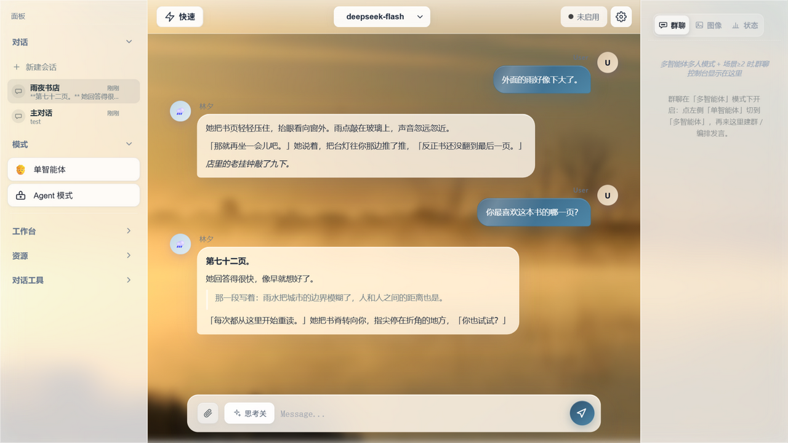
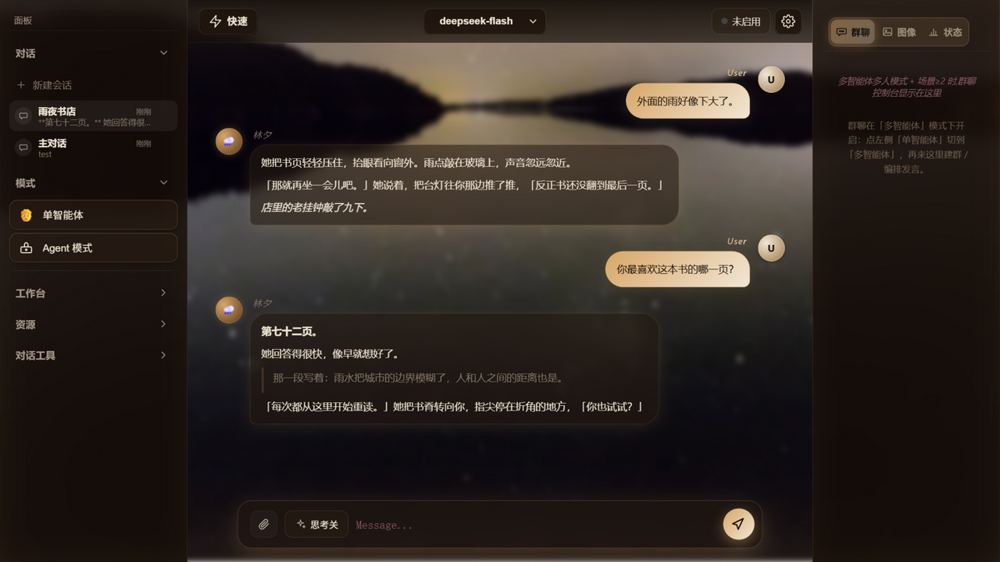
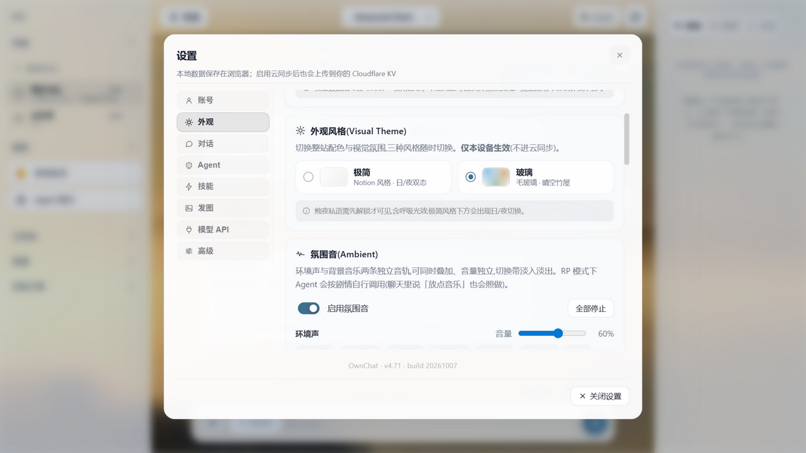

# OwnChat

**English** | [中文](README.zh-CN.md)

A self-hosted AI creation platform for roleplay, long-form writing, coding and image/voice work — deploy it to your own Cloudflare account and keep your data and API keys to yourself.



## Screenshots

| Chat · glass theme | Chat · candle theme | Settings |
|---|---|---|
|  |  |  |

## Features

- **Roleplay & multi-branch conversation** — character cards (SillyTavern V1/V2/V3 and PNG cards import/export), lorebooks, affinity tracking, group chat, multi-agent orchestration.
- **Long-form writing & code collaboration** — a prompt-editor for reusable instruction modules, skills, and per-scene presets.
- **Agent mode** — a tool-calling loop with web search/fetch, a virtual file workspace, image sending, ambient-audio direction, and an on-screen run console.
- **Image & voice** — image generation/editing through your own provider, local TTS (GPT-SoVITS) on desktop.
- **Ambient audio** — two independent decks (environment × music) with 30 bundled CC0 tracks; the model can direct them from roleplay context via hidden tags.
- **Themes** — minimal / glass / candle, per-device.
- **Self-hosted by design** — no vendor backend, no telemetry; your Worker, your KV, your keys.

## Self-hosting (Cloudflare Workers)

Requirements: a Cloudflare account (free tier is fine) and Node.js 18+.

```bash
git clone https://github.com/<you>/OwnChat && cd OwnChat
npm i -g wrangler && wrangler login

# 1) create the KV namespace used for optional sync, then paste the printed id
#    into wrangler.toml -> [[kv_namespaces]] id
wrangler kv namespace create TAVERN_SYNC

# 2) server-side model keys (never committed; only the ones you use are required)
wrangler secret put DEEPSEEK_API_KEY
wrangler secret put NVIDIA_API_KEY

# 3) deploy (the build step regenerates prompt registries + runs a syntax gate)
wrangler deploy
```

`wrangler deploy` prints your Worker URL. A custom domain is optional (Workers → your Worker → Settings → Domains & Routes).

Local development: `wrangler dev`, with secrets in `.dev.vars` (git-ignored).

## Desktop & Android builds

The Tauri 2 shell lives in `src-tauri/`. CI (`.github/workflows/tauri-build.yml`) builds a Windows installer and a debug APK on a version tag or manual dispatch.

Before publishing your own builds:

1. **Point the shell at your deployment.** In `src-tauri/tauri.conf.json` set `app.windows[0].url` to your domain (`https://your-domain.example/?shell=android`; the `shell=android` query enables the mobile layout) and update `capabilities/remote.json` to grant IPC to that origin.
2. **Generate your own signing key** for auto-updates:
   ```bash
   npx tauri signer generate -w ownchat.key
   ```
   Put the private key into repository secrets `TAURI_SIGNING_PRIVATE_KEY` (+ `TAURI_SIGNING_PRIVATE_KEY_PASSWORD`) and the public key into `tauri.conf.json` → `plugins.updater.pubkey`; set `plugins.updater.endpoints` to your own releases feed.
3. **Change the bundle identifier** (`identifier` in `tauri.conf.json`) if you want your builds to be a distinct app. Note it becomes the Android `applicationId`, so changing it later means a reinstall.

## Adding your own base prompts

Put any `.md` / `.txt` file (or a folder of them) into `src/prompts/bases/`; the build step scans that directory and the file name becomes the id shown in Settings → 对话 → 基座. No code changes needed.

Prompt libraries that ship with the repo are credited in `src/prompts/CREDITS.md`; bundled ambient audio in `public/assets/ambient/CREDITS.txt`.

## Privacy & License

- Privacy policy: [PRIVACY.md](PRIVACY.md) — data stays on your machine / in your own Cloudflare account; no telemetry.
- License: [MIT](LICENSE).

## Conventions

See [AGENTS.md](AGENTS.md) for architecture notes and development conventions. Two house rules worth knowing before you send a PR:

- **Commit messages and GitHub metadata (repo description, release notes, PR titles) are written in English.**
- The prompt files under `src/prompts/bases/` are payloads, not documents — byte-exact text matters.

Third-party credits: prompt libraries (`src/prompts/CREDITS.md`), ambient audio (`public/assets/ambient/CREDITS.txt`), and the wallpaper used in the screenshots (see README of `docs/`).
