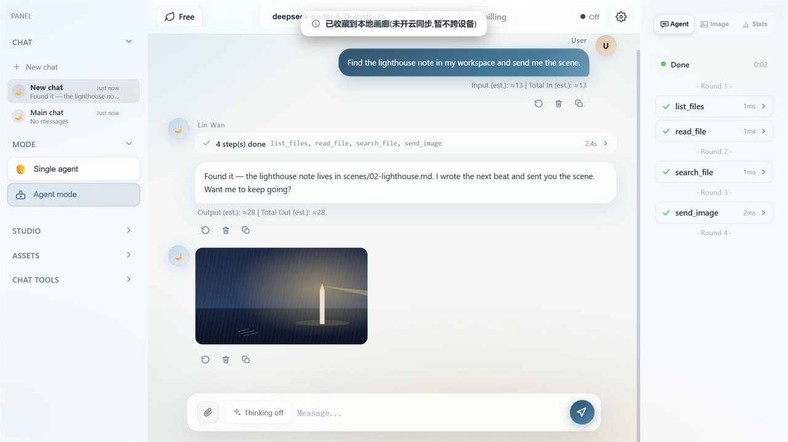
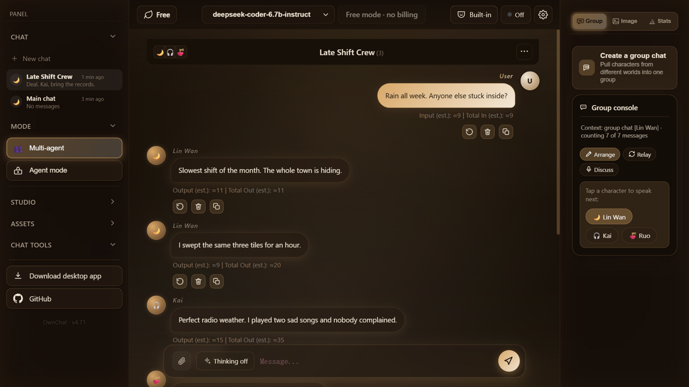
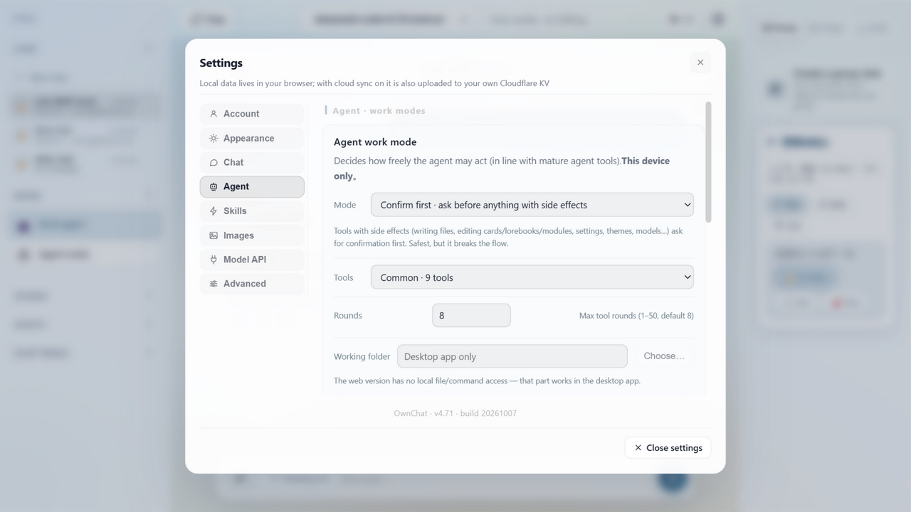

# OwnChat

[English](README.md) | **中文**

数据与密钥都留在你自己手里的 AI 创作平台 —— 部署到你自己的 Cloudflare 账号，角色扮演、长文写作、代码协作、图像与语音都在同一套界面里完成。



## 界面截图

| Agent 模式：工具调用 · 放行 · 发图（玻璃） | 多智能体群聊（烛夜） | 设置面板 |
|---|---|---|
|  |  |  |

## 功能

- **角色扮演与多分支对话** —— 角色卡（兼容 SillyTavern V1/V2/V3 与 PNG 卡导入导出）、设定集（世界书）、好感度、群聊、多智能体编排。
- **看得见全过程的 Agent 模式** —— 工具调用循环：聊天里一个可折叠的运行面板列出每次工具调用（名字 / 参数 / 结果），右栏有实时活动控制台；有副作用的操作先弹放行卡；还能自己往对话里发图。
- **多智能体编排** —— 把不同世界观的角色拉进同一个群聊；向角色开「私下小会」（结论不进时间线）；「请角色上台」让角色直接在时间线发言；主 agent 也能派子 agent 干活（最小权限、任务完成即回收）。
- **微信发图** —— 模型能在聊天中主动发照片：自拍按角色基准图改图锁定长相、场景图现生成；回复还能像微信一样拆成多条短气泡连发。
- **长文写作与代码协作** —— 提示词编辑器管理可复用的指令模块、技能与场景预设。
- **图像与语音** —— 生图走**你自己维护的图像渠道**（内置 Gitee AI 代理、任意 OpenAI 兼容端点，或本机 ComfyUI）；改图走 Gitee 预设；支持角色立绘；桌面端可用本地 TTS（GPT-SoVITS）把任意回复读出来。
- **氛围音** —— 环境声 × 背景音乐两条独立音轨，内置 30 条 CC0 音轨；RP 模式下模型可按剧情用隐藏标签自行导演。
- **主题** —— 极简 / 玻璃 / 烛夜私语，按设备生效。
- **自部署优先** —— 没有厂商后端、没有遥测；你的 Worker、你的 KV、你的密钥。

## 自部署（Cloudflare Workers）

**最快的一条路 —— 一键部署按钮。** 它会把本仓库克隆到你自己的 GitHub、自动创建 KV 存储，并在配置 Worker 的过程中问你几个密钥：

[](https://deploy.workers.cloudflare.com/?url=https://github.com/MaxChen12114/OwnChat)

它会问的那几项在 `.dev.vars.example` 里有说明（至少要一个模型 Key；强烈建议再设一个访问密码）。习惯用命令行、或已经有 Workers 环境，就走下面的手动流程：

前置：一个 Cloudflare 账号（免费配额足够）与 Node.js 18+。

```bash
git clone https://github.com/<你>/OwnChat && cd OwnChat
npm i -g wrangler && wrangler login

# 1) 建一个 KV namespace（可选云同步用），把打印出来的 id 填进
#    wrangler.toml 的 [[kv_namespaces]] id
wrangler kv namespace create TAVERN_SYNC

# 2) 服务端模型密钥（不入库；用哪个配哪个）
wrangler secret put DEEPSEEK_API_KEY
wrangler secret put NVIDIA_API_KEY

# 3) 部署（构建步骤会自动重新生成提示词注册表并跑语法门）
wrangler deploy
```

`wrangler deploy` 会打印 Worker 地址；要不要绑自定义域名随意（Workers → 你的 Worker → Settings → Domains & Routes）。

## 在你自己电脑上跑（方案 C，不需要域名）

如果 `*.workers.dev` 在你这里访问不了（国内就是这样），或者你不想花钱租域名 —— 可以把整套服务跑在你自己电脑上：同一份代码，不需要 Cloudflare 账号。

1. 安装 **Node.js 18+**（[nodejs.org/zh-cn](https://nodejs.org/zh-cn)）。
2. 下载源码：[Releases](https://github.com/MaxChen12114/OwnChat/releases/latest) 页的源码压缩包，或 `git clone https://github.com/MaxChen12114/OwnChat`。
3. 进目录运行 **`start-local.cmd`**（Windows 直接双击）或 **`bash start-local.sh`**（macOS / Linux）。第一次会生成 `.dev.vars` 并自动打开，把模型 Key（NVIDIA 或 DeepSeek）填上保存。
4. 打开桌面应用，在设置页点 **「填入本机地址」**（或手填 `http://127.0.0.1:8787`）→ 连接。

注意事项：

- 服务只在那扇窗口开着时存在 —— 你要用它的时候电脑得开着。
- 手机想连同一台电脑：启动命令换成 `npx wrangler dev --ip 0.0.0.0 --port 8787`，应用里填 `http://<电脑局域网IP>:8787`。
- 数据**按站点来源分开存**：本地跑的这一份和线上部署的那份是两套，互不相通。
- 本地跑要用云同步，得在 `.dev.vars` 里设 `CHAT_PASSWORD`（否则那些接口返回 401）。
- 不需要 `npm install` —— 构建步骤只用 Node。
- `npx wrangler dev`（或 `npm run dev`）就是普通的本地开发方式；密钥放 `.dev.vars`（已 git-ignore）。

## 桌面端与安卓构建

Tauri 2 打包工程在 `src-tauri/`；CI（`.github/workflows/tauri-build.yml`）会在打版本标签或手动触发时构建 Windows 安装包与安卓 APK（带 `-test` 的标签出 draft 包，供测试装机）。

**壳是"域中立"的**：首次启动会显示一个本地设置页，填你自己的部署地址即可进入 —— 也可以让服务直接跑在你自己电脑上（见上一节），或跟着页内那个约 3 分钟的一键部署向导走。**指向自己的 Worker 不需要重新构建**；本地能力（选定目录下的文件读写、带系统确认框的命令执行）只会授予你配置的那一个来源，且仅此一个。

发布你自己的构建、或想让构建跳过设置页直连某站时：

1. **（可选）写死默认地址**：`src-tauri/tauri.conf.json` 里 `app.windows[0].url` 填 `https://你的域名/?shell=android`（`shell=android` 启用移动端布局）；不填就走设置页。
2. **生成你自己的签名密钥**（自动更新用）：
   ```bash
   npx tauri signer generate -w ownchat.key
   ```
   私钥放仓库 Secrets：`TAURI_SIGNING_PRIVATE_KEY`（+ 密码）；公钥填进 `tauri.conf.json` → `plugins.updater.pubkey`，更新源 `plugins.updater.endpoints` 指向你自己的 Releases。
3. **改 bundle identifier**（`tauri.conf.json` 的 `identifier`）如果你想让自己的构建成为一个独立应用。注意它就是安卓的 `applicationId`，上线后再改等于换应用（需卸载重装）。

## 两套基座目录

**基座**是 system 提示词的第一段，决定模型在整个应用里的行为方式。仓库自带**两套目录**，顶栏那个按钮在两者之间切换：

| 目录 | 按钮态 | 放什么 |
| --- | --- | --- |
| `src/prompts/bases/` | 内置 | 随包一份通用「基础」；你自己的正经提示词也可以放这里 |
| `src/prompts/custom/` | 自定义 | 你自己留着用的那份 —— 只有你的部署看得见 |

要加自己的：

1. 把任意 `.md` / `.txt`（或一整个文件夹 = 一套多文件基座）丢进你要用的那个目录。
2. 部署（构建步骤会自动扫描这两个目录；**文件名 / 文件夹名就是设置里「对话 → 基座」对应下拉显示的 id**）。
3. 同一目录里有多份时，在 **设置 → 对话 → 基座** 里选具体档位；顶栏按钮只管切换目录。`custom/` 目录为空时按钮不会切过去（会提示你怎么放文件）。

> **别把 `custom/` 提交进公开仓库。** 如果你 fork 了本仓库并公开推送，把该目录加进 `.gitignore`。

> **本仓库不提供什么。** 只含 `bases/` 里那一套通用基座，`custom/` 随包是空的。项目不附带、不审核、也不为任何其他基座文本背书 —— 使用者自行添加、自行负责，并有责任遵守所在地区的法律与你所用模型服务商的条款。

基座文件是**载荷不是文档**：逐字节进入模型请求（保持 LF，`.gitattributes` 已钉死）。

随仓库分发的提示词库来源见 `src/prompts/CREDITS.md`，内置氛围音来源见 `public/assets/ambient/CREDITS.txt`。

## 图像与语音

**图像。** 生图在 **设置 → 模型 API → 图像渠道** 里按**渠道**配置，支持三类：

- **Gitee AI（内置预设）** —— 经部署的 `/img/*` 代理调用 `ai.gitee.com`，需自备 Gitee AI Key。文生图用 `z-image-turbo`（最大 2048×2048），改图用 `Qwen-Image-Edit-2511`，agent 的图生视频工具用 `Wan2_2-I2V-A14B`（走 Gitee 异步任务接口）。免费额度约 **100 张/天**，应用内的本地计数只统计走代理的调用。
- **OpenAI 兼容端点** —— 浏览器直连，用该渠道自己的 Key；服务商必须允许 CORS。只支持生图，自定义渠道暂不支持改图。
- **本机 ComfyUI** —— 直连它的 `/prompt`、`/history`、`/view`；服务端需允许 CORS，且浏览器能访问到。只支持生图；ckpt 与 steps 按渠道配置。

新增渠道时点 **+ 新增**，填 Base URL、Key（可留空）和模型列表，再点 **保存**。图像工坊、角色立绘、聊天发图路径与创作工坊页都会跟随当前渠道。渠道配置和 Key 只存本机、不进云同步。**改图**目前只支持 Gitee 预设。部署设了访问密码时，走代理的图像接口和其余接口一样需要先登录。

**语音（仅桌面版）。** 朗读需要本机跑一个 [GPT-SoVITS](https://github.com/RVC-Boss/GPT-SoVITS) 的 `api_v2` 服务（默认 `127.0.0.1:9880`），托盘菜单可以启动它、也能设置开机自启。参考音频是**本机文件路径**，不会上传；支持扫描 `.ckpt` / `.pth` 音色模型热切与多参考音频。端口存在应用的本地设置里，目前 App 内没有改端口的界面。

## 社区资源

与 OwnChat 搭配使用的第三方项目。**与本项目无关联、未经审核、不构成背书** —— 下列内容一律不复制进本仓库：

- **TTS 后端** —— 本项目内置对接 [GPT-SoVITS](https://github.com/RVC-Boss/GPT-SoVITS)（本机 `api_v2` 的 `/tts`，默认 9880，支持音色克隆与权重热切；该项目更新很活跃）。社区里同类可自托管的中文音色克隆方案还有 [IndexTTS](https://github.com/index-tts/index-tts)、[CosyVoice](https://github.com/FunAudioLLM/CosyVoice)、[Chatterbox](https://github.com/resemble-ai/chatterbox)、[F5-TTS](https://github.com/SWivid/F5-TTS) 等 —— **它们的 HTTP 接口形状各不相同（多数字不是 OpenAI `/v1/audio/speech`，接入需自行适配），模型权重许可证也不统一（部分禁商用）**，接入前请以各自仓库的 LICENSE 为准。
- **[Spiritual-Spell-Red-Teaming](https://github.com/Goochbeater/Spiritual-Spell-Red-Teaming)** —— 面向多种大模型的越狱 / 红队提示词合集（以 Claude 为主）。**点进去之前先看警告**：它**没有 LICENSE**，含可产生成人向内容的越狱提示词与收集来的各家厂商系统提示词，**且其 README 里嵌了一段针对 AI 的隐藏提示词注入** —— 别把它整份喂给 AI 助手 / agent，请自己人眼看。若你在自己的部署里用了其中内容，后果自负：请遵守当地法律与各模型服务商的条款。（按本仓库一贯政策，无协议文本从不复制进 `src/prompts/`，只做链接。）

放进自己部署后想让它跟在顶栏按钮后面？这类内容明显属于「自定义」那一档 —— 把你要用的部分放进 `src/prompts/custom/` 并部署，顶栏按钮切到「自定义」即可（记得别把该目录提交进公开仓库）。

## 隐私与许可

- 隐私政策：[PRIVACY.md](PRIVACY.md) —— 数据只在你本机 / 你自己账号的 Cloudflare KV；无遥测。
- 开源协议：[MIT](LICENSE)。

## 开发约定

架构说明与开发约定见 [AGENTS.md](AGENTS.md)。提 PR 前值得知道的两条：

- **提交信息与 GitHub 元数据（仓库简介、Release 说明、PR 标题）一律用英文。**
- `src/prompts/bases/` 与 `src/prompts/custom/` 下的提示词是**载荷不是文档** —— 逐字节都要保持原样。

第三方致谢：提示词库（`src/prompts/CREDITS.md`）、氛围音（`public/assets/ambient/CREDITS.txt`）、截图所用壁纸（见 `docs/` 说明）。
