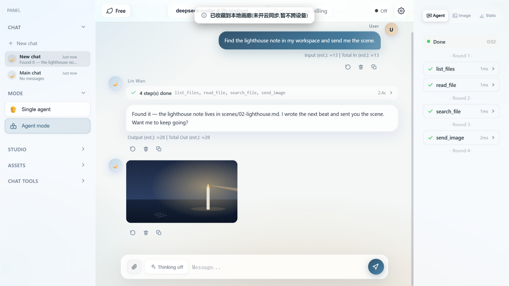

# OwnChat

[English](README.md) | **中文**

一个自托管的 AI 创作平台：角色扮演、长篇写作、代码协作、图像与语音。**默认就是在自己电脑上开箱即用**——桌面版会启动本机宿主，所有对话都存在本地 SQLite 里；把它发布成你自己的网站只是可选项。



## 界面截图

| Agent 模式 —— 工具调用 / 审批 / 图片回复（玻璃） | 多智能体群聊（烛光） | 设置页 |
|---|---|---|
|  |  |  |

## 从这里开始

### 1. 桌面版（推荐：除了安装包什么都不用装）

1. 从 [Releases](https://github.com/MaxChen12114/OwnChat/releases/latest) 下载最新安装包。
2. 安装并启动。首次向导只问两件事：**管理员密码**和**模型 Key**。
3. 完成。应用会在 `127.0.0.1:8787` 启动自己的本机宿主，加载随包页面，数据存进应用数据目录里的 SQLite。

不需要 Cloudflare 账号、不需要域名、不需要另外装 Node：Windows 安装包**内置了 Node 24 运行时**。托盘菜单可以更改数据目录、打开数据目录，或把应用指向另一个宿主地址（比如你之后自己部署的实例）。安装包启动时会自动检查更新。

### 2. 从源码运行（同样完全本地）

需要 **Node.js 24+**（[nodejs.org/zh-cn](https://nodejs.org/zh-cn)）——本机宿主使用 `node:sqlite`，更低版本没有这个模块。

```bash
git clone https://github.com/MaxChen12114/OwnChat && cd OwnChat
node server/local.mjs --port 8787
```

Windows 也可以直接双击 `start-local.cmd`：它会从示例生成 `.dev.vars`，然后运行同一条命令。

- 首次启动会在数据目录（默认 `.local-data/`）生成 `admin-password.txt` 并打印路径；用它登录 `http://127.0.0.1:8787`。
- 模型 Key 放在 `.dev.vars`（复制 `.dev.vars.example` 改）；`.dev.vars` 已被 git 忽略。
- 想让同一局域网的手机访问：加 `--host 0.0.0.0`，手机打开 `http://<电脑局域网IP>:8787`。
- 数据都在 `.local-data/`（SQLite）。搬走这个目录就等于搬走整个安装。

### 3. 你自己的网站（可选）

也可以把同一份代码部署成**你自己的网站**（Cloudflare Workers）。这个页面属于你：跑在你的账号里，数据在你自己的 D1/KV 里；新部署默认是**访客模式**（不登录），直到你设置访问密码。

**一键部署：** 下面的按钮会把仓库克隆到你的 GitHub、自动创建 **KV 与 D1**，并询问密钥：

[](https://deploy.workers.cloudflare.com/?url=https://github.com/MaxChen12114/OwnChat)

部署脚本会顺带执行数据库迁移，所以第一次打开就已经是统一 schema。

**命令行手动部署**（Node 24+，Cloudflare 账号免费额度即可）：

```bash
git clone https://github.com/<你>/OwnChat && cd OwnChat
npm i -g wrangler && wrangler login

# 1) KV namespace（热窗口同步），把打印的 id 填进 wrangler.toml
wrangler kv namespace create TAVERN_SYNC

# 2) D1 数据库（消息归档 / 角色卡 / 记忆 / 工作区 / 附件）
wrangler d1 create ownchat-events
#    把打印的 database_id 填进 wrangler.toml -> [[d1_databases]] database_id

# 3) 应用 schema，再设置密钥
wrangler d1 migrations apply TAVERN_EVENTS --remote
wrangler secret put DEEPSEEK_API_KEY     # 或 NVIDIA_API_KEY，用哪个配哪个
wrangler secret put CHAT_PASSWORD        # 强烈建议；不设就是访客模式

# 4) 部署（构建步骤会重新生成提示词注册表并跑语法门）
wrangler deploy
```

`wrangler deploy` 会打印你的 Worker 地址；绑自定义域名是可选的。

> **访客模式**：不设 `CHAT_PASSWORD` 时，任何拿到网址的人都能使用你的部署（如果你配了服务端模型 Key，消耗的也是你的额度）。分享地址前请先设置密码；同一个密码也是应用内的登录密码。

## 仓库结构

| 目录 | 职责 |
|---|---|
| `public/` | 前端页面、工具页与运行时产物 |
| `src/` | Cloudflare Worker：聊天、同步、数据面与部署 API |
| `server/` | 本机 Node 宿主（桌面随包 / 自托管入口） |
| `src-tauri/` | Tauri 2 桌面壳与打包配置 |
| `core/ lib/ services/` | 架构分层：契约 / 纯算法 / 平台服务 |
| `tooling/` | 构建与检查：`l0/` 生成器、`scripts/` 门禁、`bundles/` 工具清单、`boot.ts` |
| `deploy/ migrations/` | Cloudflare / VPS 部署模板与统一 SQL schema |
| `docs/` | 公开文档、截图与品牌素材 |

## 功能

- **一个本地存储装下所有数据** —— 对话、角色卡、记忆、知识库、Agent 工作区、附件都在同一套 SQLite 里（部署后是 D1）。长对话会自动压缩，但原文仍在归档里，可随时用 `history_search` 回捞。
- **角色扮演与多分支对话** —— 角色卡（SillyTavern V1/V2/V3 与 PNG 卡导入导出）、世界书、好感度、群聊、多智能体编排。
- **看得见的 Agent 模式** —— 工具调用循环在对话里有可折叠的运行面板（每次工具、参数、结果），右栏还有实时控制台；破坏性操作先审批，Agent 也能主动往对话里发图。
- **多智能体编排** —— 把不同世界的角色拉进一个群聊、开小会（不上时间线）、或让角色上台直接回复。
- **微信式图片消息** —— 模型可以在对话中主动发照片：自拍按角色参考图重绘保持一致，场景图现生成；回复也可以拆成多条短气泡。
- **长篇写作与代码协作** —— 可复用的指令模块、技能、按场景的预设，统一在提示词编辑器里管理。
- **图像与语音** —— 图像走你自己的渠道（内置 Gitee AI 代理、任意 OpenAI 兼容端点、本地 ComfyUI）；角色立绘；桌面版可用本地 GPT-SoVITS 朗读任意回复。
- **备份与恢复** —— 设置 → 数据 可把整套存储导出为 ZIP 再导入；导入会从事件日志重建检索索引，换机器也能恢复。
- **环境音** —— 环境声 × 音乐两条独立音轨，内置 30 首 CC0 曲目。
- **主题** —— 极简 / 玻璃 / 烛光，按设备保存。
- **自托管为本** —— 没有厂商后端、没有遥测；用你自己的机器或你自己的 Cloudflare 账号，Key 也在你手里。

## 桌面端与安卓构建

Tauri 2 打包工程在 `src-tauri/`；CI（`.github/workflows/tauri-build.yml`）在打版本标签或手动触发时构建 Windows 安装包与安卓 APK（带 `-test` 的标签出 draft 包，供测试装机）。

- **桌面版是自包含的**：安装包内置 UI、本机宿主与 Node 24 运行时；首次启动在 `127.0.0.1:8787` 起宿主，数据放在应用数据目录。页面不会跳转到远端站点——宿主地址只决定 API 往哪走，所以换宿主不用换应用。
- **安卓版是瘦客户端**：加载随包 UI，但需要一个可访问的宿主（你自己部署的实例，或局域网里的桌面宿主）。安卓跑不了本机 Node 宿主，所以手机上要连一个你自己控制的宿主。

如果要发布你自己的构建：

1. **生成自己的更新签名密钥**：
   ```bash
   npx tauri signer generate -w ownchat.key
   ```
   私钥放进仓库 Secrets `TAURI_SIGNING_PRIVATE_KEY`（有密码再加 `TAURI_SIGNING_PRIVATE_KEY_PASSWORD`），公钥写进 `tauri.conf.json` → `plugins.updater.pubkey`，并把 `plugins.updater.endpoints` 指向你自己的发布源。
2. **改 bundle identifier**（`tauri.conf.json` 里的 `identifier`），让你的构建成为独立应用。它会变成安卓的 `applicationId`，之后修改需要重装。

## 基座提示词

**基座**是系统提示的第一段，决定模型在整个应用里的行为。仓库按模式分两个目录：

| 目录 | 模式 | 放什么 |
| --- | --- | --- |
| `src/prompts/bases/unlocked/` | 解锁态 | 解锁模式使用的基座。公开仓库随包一份中性基座；你可以在这里加自己的文件或目录 |
| `src/prompts/bases/locked/` | 锁定态 | 锁定模式使用的基础行为准则，随仓库维护，可编辑 |

添加自己的基座：把任意 `.md` / `.txt` 文件——或一个装着它们的目录（= 一套多文件基座）——放进对应模式的目录；文件/目录名就是 **设置 → 对话 → 基座** 里显示的 id。一个目录里有多个基座时，在那里选当前生效的那份。基座是**载荷，不是文档**——字节会原样进入模型请求（保持 LF；`.gitattributes` 已锁）。

> **别把私人的提示词正文提交进公开 fork。** 基座就是普通文件；私人版本请留在自己的私有仓库。

随仓库分发的提示词库署名在 `src/prompts/CREDITS.md`；内置环境音在 `public/assets/ambient/CREDITS.txt`。

## 图像与语音

**图像。** 图像渠道在 **设置 → 模型 API → 图像渠道** 里配置，支持三类：

- **Gitee AI（内置预设）** —— 经部署的 `/img/*` 代理调用 `ai.gitee.com`，需要你自己的 Gitee AI Key。文生图用 `z-image-turbo`（最高 2048×2048），编辑用 `Qwen-Image-Edit-2511`，Agent 的图生视频工具经 Gitee 异步任务 API 调 `Wan2_2-I2V-A14B`。免费额度约每天 100 张；应用内有本地计数。
- **OpenAI 兼容端点** —— 浏览器带该渠道自己的 Key 直连，服务商必须允许 CORS。仅生成；自定义渠道暂不支持编辑。
- **本地 ComfyUI** —— 直连它的 `/prompt`、`/history`、`/view`，需要允许 CORS 且浏览器可达。仅生成；每个渠道可设 checkpoint 与步数。

渠道设置与 Key 只留在你的设备上，不入同步。**编辑**目前需要 Gitee 预设。设了访问密码的部署，代理类图像接口和其余接口一样需要先登录。

**语音（仅桌面版）。** 朗读需要本地 [GPT-SoVITS](https://github.com/RVC-Boss/GPT-SoVITS) 的 `api_v2` 服务（默认 `127.0.0.1:9880`）；托盘菜单可以启动它并设置开机自启。参考音频是**本地文件路径**，从不上传；`.ckpt` / `.pth` 模型会扫描并支持热切换，也支持多段参考音频。

## 社区资源

与本项目搭配使用的第三方项目。**与本项目无隶属关系、未经审核、也不构成背书**——下面的内容不会被复制进本仓库：

- **TTS 后端** —— 本项目集成 [GPT-SoVITS](https://github.com/RVC-Boss/GPT-SoVITS)（本地 `api_v2` `/tts`，默认 9880；热切换权重的声音克隆；活跃维护）。其他可自托管的中文声音克隆方案还有 [IndexTTS](https://github.com/index-tts/index-tts)、[CosyVoice](https://github.com/FunAudioLLM/CosyVoice)、[Chatterbox](https://github.com/resemble-ai/chatterbox)、[F5-TTS](https://github.com/SWivid/F5-TTS) —— 但**它们的 HTTP 形状不同、模型权重许可也各不相同**，接入前请自行核对。
- **[Spiritual-Spell-Red-Teaming](https://github.com/Goochbeater/Spiritual-Spell-Red-Teaming)** —— 一个大型社区红队/越狱提示词合集。**点开前先读警告**：它**没有许可证**，包含成人/NSFW 越狱提示词与厂商系统提示词，而且**它的 README 里藏着针对 AI 工具的提示词注入文本**——不要把那份 README 贴进任何 AI 助手或 Agent。若你在自己的部署里使用其中内容，责任由你承担：请遵守你所在地法律与各模型服务商的条款。

## 隐私与许可

- 隐私说明：[PRIVACY.md](PRIVACY.md) —— 数据留在你的机器 / 你自己的 Cloudflare 账号里；没有遥测。
- 许可证：[MIT](LICENSE)。

## 开发约定

架构说明与开发约定见 [AGENTS.md](AGENTS.md)。提交 PR 前有两条约定：

- **提交信息与 GitHub 元数据（仓库简介、Release 说明、PR 标题）一律用英文。**
- `src/prompts/bases/` 下的提示词是载荷，不是文档——字节必须保持一致。

第三方署名：提示词库（`src/prompts/CREDITS.md`）、环境音（`public/assets/ambient/CREDITS.txt`）、截图壁纸（见 `docs/` 的 README）。
