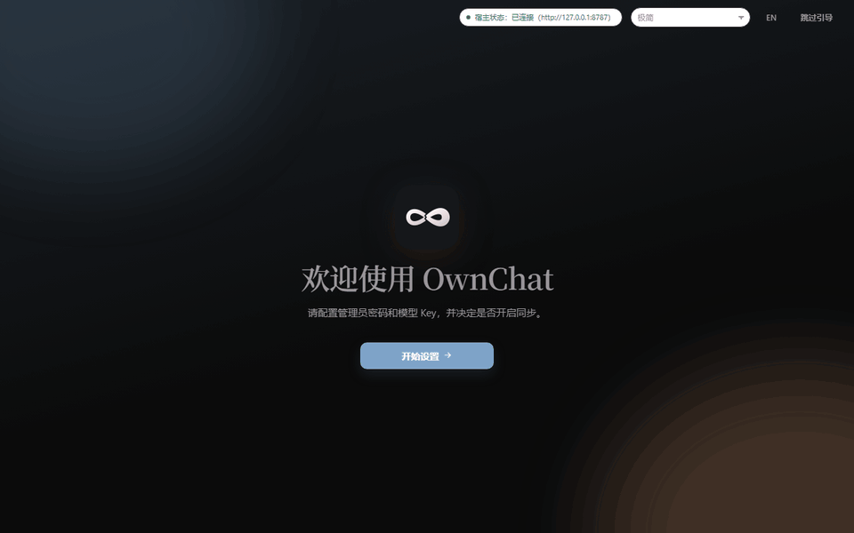
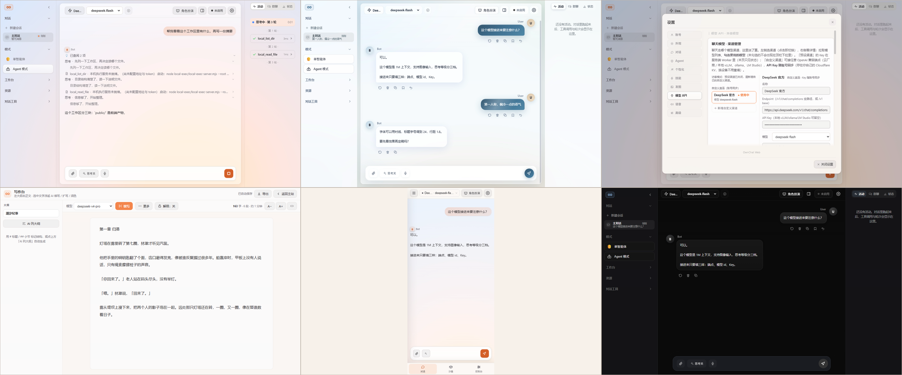

# OwnChat

[English](README.md) | **中文**

[](LICENSE)
[](https://workers.cloudflare.com/)
[](https://tauri.app/)
[](https://nodejs.org/)
[](PRIVACY.md)



## 界面



六个界面拼成一张图：Agent 模式、多智能体群聊、消息、主题、写作、手机端。点击查看原尺寸。

-----

## 概述

OwnChat 跑在你自己机器上。桌面版启动时在本机起一个宿主进程（`127.0.0.1:8787`），页面从安装包内的资源加载，数据写入应用数据目录的 SQLite 数据库。角色扮演、长文写作、代码协作、图像与语音在同一套界面里。

它不连接厂商后端，也不收集使用数据。同一份代码可以部署到 Cloudflare Workers 当作你自己的站点，也可以用 `node server/local.mjs` 当本地网页应用运行；三种方式共用一套界面和一份数据结构。

它没有多用户与权限体系。一个部署或一个数据目录对应一个使用者，需要隔离就部署多份。

-----

## 快速开始

| 方式 | 适用 | 前置条件 |
| --- | --- | --- |
| 桌面版 | 直接使用 | Windows 安装包 |
| 从源码运行 | 阅读或修改代码 | Node.js 24+ |
| 部署成网站 | 供他人访问与跨设备同步 | Cloudflare 账号，免费额度够用 |

### 桌面版

安装包内置 Node 24 运行时、本机宿主和全部页面资源，不需要另外安装。

1. 从 [Releases](https://github.com/MaxChen12114/OwnChat/releases/latest) 下载最新安装包。
2. 安装并启动。首次向导要求管理员密码与模型 Key，同步开关可选。
3. 应用在 `127.0.0.1:8787` 起宿主，数据写入应用数据目录。

托盘菜单可以更换数据目录、打开数据目录，或把应用指向另一个宿主地址。启动时检查更新。当前只发布 Windows 安装包；macOS 与 Linux 需要从源码运行本机宿主。

### 从源码运行

需要 Node.js 24+，本机宿主使用 `node:sqlite`。

```bash
git clone https://github.com/MaxChen12114/OwnChat && cd OwnChat
node server/local.mjs --port 8787
```

Windows 上可以双击 `start-local.cmd`，它执行同一条命令。

首次启动在数据目录（默认 `.local-data/`）写入 `admin-password.txt` 并打印路径，用它登录。模型 Key 放在 `.dev.vars`，从 `.dev.vars.example` 复制；该文件已被 git 忽略。局域网内用手机访问时加 `--host 0.0.0.0`，然后打开 `http://<电脑局域网IP>:8787`。整个安装就是 `.local-data/` 这一个目录，搬走它即搬走全部数据。

### 部署成网站

部署到 Cloudflare Workers 后，站点跑在你的账号里，数据在你的 D1/KV 里，手机与桌面可以跨网络同步。未设置 `CHAT_PASSWORD` 的部署处于访客模式，任何拿到地址的人都能使用，包括你配置的服务端模型额度。

[](https://deploy.workers.cloudflare.com/?url=https://github.com/MaxChen12114/OwnChat)

按钮会把仓库克隆到你的 GitHub、创建 KV 与 D1，并询问密钥。部署脚本会执行数据库迁移，第一次打开即使用统一 schema。

<details>
<summary>命令行部署</summary>

需要 Node 24+ 与 Cloudflare 账号：

```bash
git clone https://github.com/<你>/OwnChat && cd OwnChat
npm i -g wrangler && wrangler login

# KV：热窗口同步，把打印的 id 填进 wrangler.toml
wrangler kv namespace create TAVERN_SYNC

# D1：消息归档、角色卡、记忆、工作区、附件
wrangler d1 create ownchat-events
# 把打印的 database_id 填进 wrangler.toml -> [[d1_databases]] database_id

# 应用 schema，设置密钥
wrangler d1 migrations apply TAVERN_EVENTS --remote
wrangler secret put DEEPSEEK_API_KEY     # 或 NVIDIA_API_KEY，用哪个配哪个
wrangler secret put CHAT_PASSWORD        # 不设即访客模式

# 部署；构建步骤会重新生成提示词注册表并跑语法门
wrangler deploy
```

`wrangler deploy` 打印 Worker 地址，绑定自定义域名可选。

</details>

-----

## 功能

| | |
| --- | --- |
| 数据面 | 对话、角色卡、记忆、知识库、Agent 工作区与附件存放在同一个 SQLite（部署后为 D1）；长对话按上下文预算压缩，原文留在事件日志中可用 `history_search` 检索 |
| 跨设备同步 | 五个通道各自按自然键合并（会话 slot 哈希、角色卡 id、费用天×设备、排除项时间戳），删除使用墓碑；账号内的 Provider 配置与 Key 一并同步 |
| 模型 | 从上游 `/v1/models` 拉取清单后勾选，不写死版本号；DeepSeek 官方通道与 NVIDIA 免费档内置，可另加任意 OpenAI 兼容端点；思考等级按模型映射 |
| 备份 | 设置 → 数据 导出整个库为 ZIP；导入时从事件日志重建搜索索引，因此备份可在另一台机器恢复 |
| 角色扮演 | 导入导出 SillyTavern V1/V2/V3 与 PNG 角色卡；世界书、好感度、多分支对话 |
| 群聊与多智能体 | 不同角色加入同一会话；私下小会不进入时间线；可以让角色直接在时间线回复；主 Agent 可派子 Agent 执行任务，任务结束回收权限 |
| Agent 执行 | 每次工具调用展开为运行面板，列出工具名、参数与结果；右栏控制台显示当前步骤；有副作用的操作先请求放行 |
| 消息呈现 | 模型可在对话中发送图片，自拍按角色参考图重新生成以保持面部一致；一条回复可拆成多条短消息 |
| 写作与代码 | 提示词编辑器管理指令模块、技能与场景预设；代码块高亮 |
| 图像渠道 | 内置 Gitee AI 预设、任意 OpenAI 兼容端点、本地 ComfyUI |
| 语音 | 桌面版通过本地 GPT-SoVITS 朗读回复，参考音频是本地路径，不上传 |
| 环境音 | 环境声与背景音乐两条独立音轨，内置 30 首 CC0 曲目；模型在角色扮演中可用隐藏标签切换 |
| 手机端 | 同一部署在手机上使用单列布局与胶囊式输入条；安卓壳连接你指定的宿主 |

## 已知限制

这些是当前版本的实际边界，不是待办清单。

- **桌面版只发布 Windows 安装包。** macOS 与 Linux 需要从源码运行本机宿主。
- **跨设备同步需要一个两台设备都能访问的宿主。** 纯本机运行时同步只覆盖同一局域网。
- **安卓版是瘦客户端。** 它加载随包界面，但必须连接一个可访问的宿主；安卓无法运行本机 Node 宿主。
- **语音需要额外的本地服务。** 朗读依赖本地 GPT-SoVITS 的 `api_v2` 接口（默认 `127.0.0.1:9880`），仓库不提供模型权重。
- **图像编辑只支持 Gitee 预设。** OpenAI 兼容端点与本地 ComfyUI 只支持生成。
- **长对话会被压缩。** 超出上下文预算的旧消息被摘要，原文仍在事件日志中，可检索，但不再进入模型上下文。
- **一个部署对应一个使用者。** 没有账号与多租户隔离；需要分开使用就部署多份。
- **私密模式的底座需要自备。** 仓库随包一份中性基座作为兜底，实际使用的底座由部署者提供。

## 仓库结构

| 目录 | 职责 |
| --- | --- |
| `public/` | 前端页面、工具页与运行时产物 |
| `src/` | Cloudflare Worker：聊天、同步、数据面与部署 API |
| `server/` | 本机 Node 宿主（桌面随包 / 自托管入口） |
| `src-tauri/` | Tauri 2 桌面壳与打包配置 |
| `core/ lib/ services/` | 架构分层：契约 / 纯算法 / 平台服务 |
| `tooling/` | 构建与检查：`l0/` 生成器、`scripts/` 门禁、`bundles/` 工具清单、`boot.ts` |
| `deploy/ migrations/` | Cloudflare / VPS 模板与统一 SQL schema |
| `docs/` | 公开文档、演示图与品牌素材 |

## 桌面版与安卓构建

Tauri 2 工程在 `src-tauri/`。CI（`.github/workflows/tauri-build.yml`）在打版本标签或手动触发时构建 Windows 安装包与安卓 APK；带 `-test` 的标签出 draft 包。

桌面版是自包含的：安装包内置界面、本机宿主与 Node 24 运行时。页面不会跳转到远端站点，宿主地址只决定 API 请求发往何处，因此换宿主不需要换应用。

安卓版加载随包界面，需要一个可访问的宿主（你自己部署的实例，或局域网中的桌面宿主）。

<details>
<summary>发布自己的构建</summary>

1. 生成更新签名密钥：

   ```bash
   npx tauri signer generate -w ownchat.key
   ```

   私钥放进仓库 Secrets `TAURI_SIGNING_PRIVATE_KEY`（有密码再加 `TAURI_SIGNING_PRIVATE_KEY_PASSWORD`），公钥写进 `tauri.conf.json` → `plugins.updater.pubkey`，并将 `plugins.updater.endpoints` 指向你的发布源。

2. 修改 `tauri.conf.json` 中的 `identifier`，让你的构建成为独立应用。它会成为安卓的 `applicationId`，之后修改需要重装。

</details>

## 提示词底座

基座是系统提示的第一段，决定模型在整个应用中的行为。仓库按模式分两个目录：

| 目录 | 模式 | 内容 |
| --- | --- | --- |
| `src/prompts/bases/unlocked/` | 解锁态 | 解锁模式使用的基座。随包一份中性基座，可以添加自己的文件或目录 |
| `src/prompts/bases/locked/` | 锁定态 | 锁定模式使用的基础行为准则，随仓库维护 |

把 `.md` / `.txt` 文件或一个装着它们的目录（即一套多文件基座）放进对应目录即可添加。文件或目录名就是 **设置 → 对话 → 基座** 中显示的 id；同一目录有多个基座时在那里选择生效的一份。

基座是载荷而不是文档：字节原样进入模型请求，保持 LF，`.gitattributes` 已锁定。

> 不要把私人提示词正文提交进公开 fork。基座是普通文件，私人版本留在自己的私有仓库。

## 图像与语音

图像渠道在 **设置 → 模型 API → 图像渠道** 配置，支持三类：

- **Gitee AI（内置预设）** 经部署的 `/img/*` 代理调用 `ai.gitee.com`，需要自己的 Gitee AI Key。文生图使用 `z-image-turbo`（最高 2048×2048），编辑使用 `Qwen-Image-Edit-2511`，图生视频经 Gitee 异步任务 API 调用 `Wan2_2-I2V-A14B`。免费额度约每天 100 张，应用内保持本地计数。
- **OpenAI 兼容端点** 由浏览器携带该渠道的 Key 直连，服务商必须允许 CORS。仅生成。
- **本地 ComfyUI** 直连 `/prompt`、`/history`、`/view`，需要允许 CORS 且浏览器可达。仅生成，checkpoint 与步数按渠道设置。

渠道设置与 Key 只留在设备上，不进入同步。设置访问密码的部署，代理类图像接口需要登录。

语音仅桌面版可用，依赖本地 [GPT-SoVITS](https://github.com/RVC-Boss/GPT-SoVITS) 的 `api_v2` 服务，托盘菜单可以启动它并设置开机自启。参考音频是本地文件路径，不上传。`.ckpt` / `.pth` 模型会扫描并支持热切换，支持多段参考音频。

## 隐私与许可

- 隐私说明：[PRIVACY.md](PRIVACY.md)
- 许可证：[MIT](LICENSE)

## 开发约定

架构说明与开发约定见 [AGENTS.md](AGENTS.md)。提交 PR 前有两条：

- 提交信息与 GitHub 元数据（仓库简介、Release 说明、PR 标题）一律用英文。
- `src/prompts/bases/` 下的提示词是载荷，字节必须一致。

第三方署名：提示词库见 `src/prompts/CREDITS.md`，环境音见 `public/assets/ambient/CREDITS.txt`，演示图素材见 `docs/` 的 README。
